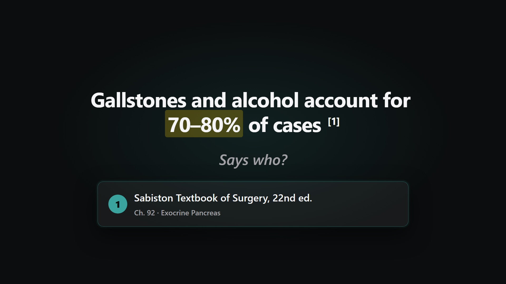
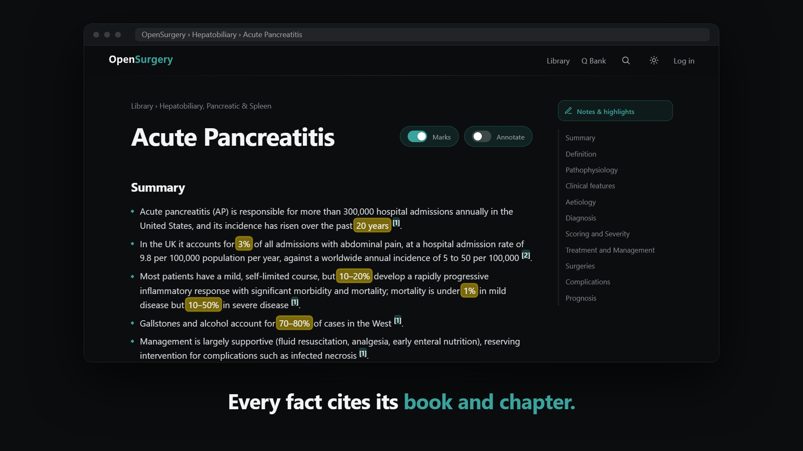

# OpenSurgery

A general surgery reference built entirely from textbooks. Every clinical statement cites the book and chapter it came from, and every question in the question bank was taken word for word from those books.

| 20-second launch | One-minute tour |
|---|---|
|  |  |

**Read it at [omar-184.github.io/OpenSurgery](https://omar-184.github.io/OpenSurgery/)**

This repository is the generated site, published with GitHub Pages. It is a revision reference, not clinical advice.
